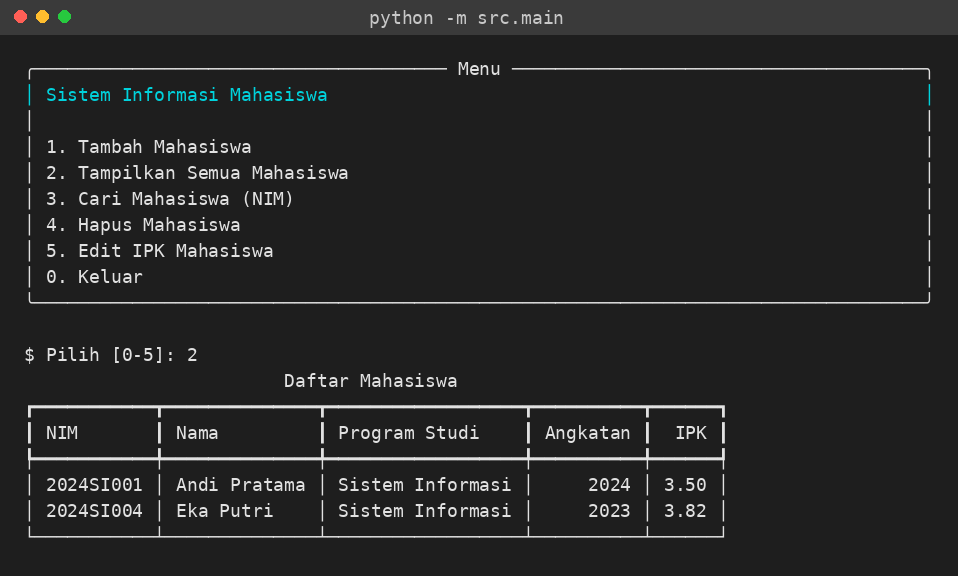

# Sistem Informasi Mahasiswa (SIM)

Aplikasi console-based untuk mengelola data mahasiswa
pada Program Studi Sistem Informasi.

## Identitas

- Nama: [Nama Lengkap]
- NIM: [NIM Anda]
- Kelas: [Kelas Praktikum]

## Fitur

- Tambah data mahasiswa (NIM, nama, prodi, angkatan, IPK)
- Tampilkan seluruh data dalam tabel
- Cari mahasiswa berdasarkan NIM
- Hapus data mahasiswa
- Edit IPK mahasiswa berdasarkan NIM (validasi 0.0 - 4.0)
- Validasi data input (NIM minimal 6 karakter, nama 1-100 karakter, IPK 0.0 - 4.0, NIM unik)

## Prasyarat

- Python 3.10+
- pip

## Instalasi

```bash
git clone https://github.com/USERNAME/sim-mahasiswa.git
cd sim-mahasiswa
python3 -m venv venv
source venv/bin/activate   # Linux/macOS
# Windows (PowerShell): venv\Scripts\Activate.ps1
pip install -r requirements.txt
```

## Penggunaan

```bash
python -m src.main
```

Menu yang tersedia:

| Pilihan | Fungsi |
|---------|--------|
| 1 | Tambah mahasiswa |
| 2 | Tampilkan semua mahasiswa |
| 3 | Cari mahasiswa (NIM) |
| 4 | Hapus mahasiswa |
| 5 | Edit IPK mahasiswa |
| 0 | Keluar |



## Pengujian

```bash
pytest tests/ -v
```

Terdapat 23 unit test: 5 test dasar dan 18 test edge case (NIM kosong,
nama sangat panjang, IPK boundary 0.0 dan 4.0, hapus/cari NIM yang tidak ada,
NIM duplikat, dan edit IPK).

## Struktur Proyek

```
sim-mahasiswa/
├── src/
│   ├── __init__.py
│   ├── main.py        # Program utama & menu
│   └── models.py      # Model data Mahasiswa & DaftarMahasiswa
├── tests/
│   ├── __init__.py
│   └── test_main.py   # Unit test
├── docs/
│   └── screenshot-output.png
├── requirements.txt
├── .gitignore
└── README.md
```

## Setup Checklist

- [x] Python terinstal (versi: 3.12.3)
- [x] Virtual environment dibuat & diaktivasi
- [ ] Paket terinstal via requirements.txt
- [x] Program berjalan tanpa error
- [x] Unit test lulus
- [x] Repositori Git diinisiasi
- [ ] Push ke GitHub berhasil
- [x] README.md lengkap
